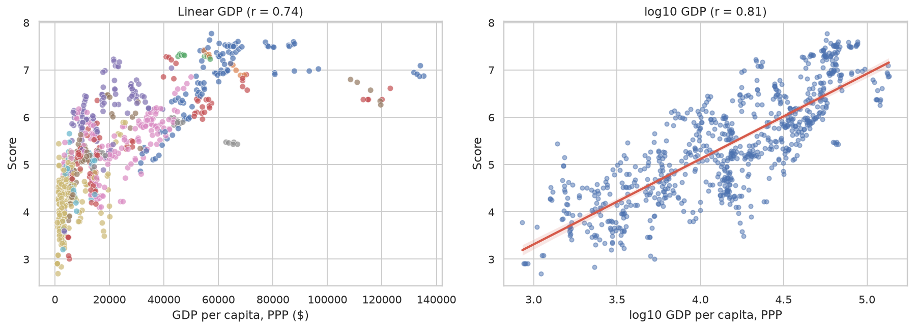

# What Makes a Country Happy? World Happiness 2015–2019

End-to-end exploratory data analysis of the World Happiness Report, enriched with World Bank income and health indicators. It covers data cleaning, merging five inconsistent yearly files, visual analysis, and an interactive Streamlit dashboard.



## Key findings
- **Happiness is stable globally but very unequal by region.** The yearly mean barely moves (5.38 → 5.41), while Western Europe and North America have medians above 7.0 and Sub-Saharan Africa sits at 4.4.
- **Income matters, with diminishing returns.** Correlation with GDP per capita is r = 0.74 on a linear scale but **r = 0.81 on a log scale**: doubling income matters more at low incomes than at high ones.
- **Health is almost as strong.** Life expectancy correlates with the score at r = 0.79.
- **GDP, health and social support carry the most weight** in a joint regression (R² = 0.76); generosity carries the least.
- **Venezuela had the biggest drop** (6.81 → 4.71); Benin, Côte d'Ivoire and Togo gained the most.

Full write-up with charts: [`notebooks/01_eda_world_happiness.ipynb`](notebooks/01_eda_world_happiness.ipynb). These are associations from a survey-derived score, not causal effects.

## Data
| Source | Used for |
|---|---|
| [World Happiness Report 2015–2019 (Kaggle)](https://www.kaggle.com/datasets/unsdsn/world-happiness) | Happiness score and its six components |
| [GDP per capita, PPP (World Bank via Our World in Data)](https://ourworldindata.org/grapher/gdp-per-capita-worldbank) | Income |
| World Bank development indicators | Life expectancy, health spending, unemployment, income group |

The merged result (782 rows, 164 countries, 2015–2019) is committed at `data/processed/merged.csv`, so the dashboard runs out of the box. Raw files are not committed. Each yearly report names its columns differently and spells some countries differently (e.g. "Ivory Coast" vs "Cote d'Ivoire"); `scripts/data_prep.py` harmonises both and joins on ISO country codes. About 12% of rows lack World Bank indicators because those countries (Egypt, Iran, Russia, South Korea, Turkey, ...) are absent from the file used.

## Run it
```bash
git clone https://github.com/bmewchaal/world-happiness-eda.git
cd world-happiness-eda
python -m venv .venv && source .venv/bin/activate   # Windows: .venv\Scripts\activate
pip install -r requirements.txt

streamlit run app/streamlit_app.py                  # interactive dashboard
```

To rebuild everything from scratch, put the raw CSVs in `data/raw/` (`2015.csv` … `2019.csv`, `gdp-per-capita-worldbank.csv`, `life expectancy.csv`), then:
```bash
python -m scripts.data_prep          # writes data/processed/merged.csv
jupyter notebook notebooks/01_eda_world_happiness.ipynb
pytest                               # data-pipeline tests
```

## Project structure
```
app/streamlit_app.py      dashboard: ranking, relationships, country trends
notebooks/                the analysis, executed with outputs
scripts/data_prep.py      load, harmonise and merge the raw files
tests/                    pytest checks for the pipeline
reports/figures/          charts exported by the notebook
data/processed/           merged dataset (raw data is git-ignored)
```

## Tech
Python · pandas · NumPy · SciPy · scikit-learn · matplotlib · seaborn · Plotly · Streamlit · pytest

## License
MIT
